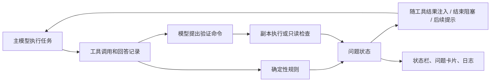

# claude-supervisor：现状、模型能力差距与演进依据

日期：2026-10-11。代码基线：`6a69b875071e3823cef5be78d928ef842ef97236`，插件清单版本 `0.8.2`。

本文是研究与设计提案，不表示新能力已经实现。配套路线图：[演进计划](../superpowers/plans/2026-10-11-evidence-driven-supervision.md)。

## 1. 目标和约束

用户确认的目标：**以较低总成本，让弱于顶级模型的主模型完成接近顶级模型质量的工程任务。**

用户补充的运行前提：**旁路模型的能力不超过主模型。** 因此明确区分三个角色：

| 角色 | 含义 | 是否参与产品运行 |
|---|---|---|
| M：主模型 | 负责理解任务、选择方案、修改产品代码、给出最终回答 | 是 |
| S：旁路模型 | 与 M 同级或更弱；执行窄范围检查、提出实验、整理证据 | 是，要求 S ≤ M |
| F：顶级参考模型 | 独立完成相同任务，作为质量和成本参照 | 只在离线对照评测中使用 |

不能把 M、S 的模型名称或参数量直接当成任务能力排序。需要记录具体模型版本、推理配置和目标任务上的测量；同一模型可以因工具、上下文、预算不同而表现不同。产品不依赖运行时调用 F，也不包含自动升级到能力超过 M 的模型。

研究问题不是“能否让 S 比 M 更聪明”，而是：**S 能否用更小的、可验证的工作，为 M 提供原本缺少的信息，使 M 少犯错、少绕路？**

用户进一步要求计划考虑工程可实施性：可持续演进、可维护、可测试和稳定性。对应要求是每阶段既验证模型质量/成本，也验证独立模块、宿主契约、真实进程隔离、取消与恢复、资源上限和发布回退。配套计划第 8–10 节给出实现边界及工程门槛；工程门槛与研究收益分别验收。

## 2. 当前项目的定位

仓库名是 `claude-supervisor`，当前实现和插件标识仍是 `deepseek-supervisor`，上游清单指向 `LACAN-1/deepseek-supervisor`。它是 Claude Code 的函数式 mods 插件，直接注册宿主事件，并非一个独立运行的编码 agent。

当前实现有三层监督：工具批次后用规则读记录；结束前检查回答是否与记录矛盾；用另一模型提出命令，在工作区副本里执行，检查主模型的陈述和修改。

这个底座的价值是把反馈接入真实执行循环，并使用执行结果约束部分监督结论。它目前覆盖的是过程失误和可执行反例，尚没有完整的需求模型、探索策略或工程决策支持。

### 2.1 代码地图

| 文件 | 当前责任 | 关键入口 |
|---|---|---|
| `hooks/register.ts` | 事件、调度、复制工作区、执行命令、模型调用、问题生命周期和反馈投递 | `register`、`check`、`verify`、`tick`、`atAnswer` |
| `hooks/evidence.ts` | 从会话工具记录抽取事实，检测矛盾和反复失败 | `evidenceOf`、`contradictions`、`recordFindings`、`settledBy`、`changesOf` |
| `hooks/prompt.ts` | 陈述抽取、验证提示、JSON 解析、命令过滤、脱敏、问题提示文本 | `claimsOf`、`verifyPrompt`、`parseTurn`、`refusal`、`noteText` |
| `hooks/band.tsx`、`hooks/weather.tsx` | 问题卡片、上下文占用和最近回合增长 | `registerBand`、`readingOf` |
| `types/index.d.ts` | `Issue`、`Track` 等状态契约 | `open/fixed/told/refuted` |
| `.claude-plugin/plugin.json` | 模型和变更审查选项 | `verifier_model`、`review_changes` |
| `tests/*.test.ts` | 规则、验证器、并发、UI 的宿主 mock 测试 | `claude-code/testing` |
| `eval/` | 对照运行、陷阱任务、评分器和压力测试 | `run.mjs`、五组 `selftest*.mjs`、`pressure.mjs` |

### 2.2 已支持能力

| 能力 | 触发和行为 | 实际边界 |
|---|---|---|
| 重复失败 `stuck` | 同一命令以相同错误连续失败三次，提示改变诊断方式 | 能识别部分循环；没有判断下一步实验的信息价值 |
| 编辑失配 `edit-miss` | 同文件两次文本替换失败，提示重新读文件 | 不保证修改方案本身正确 |
| 测试弱化 `weakened-test` | 跳过、删除断言、恒真断言、把期望改成错误输出、删除测试文件 | 正则启发式；用户允许修改或会话自产测试有豁免 |
| 忽略约束 `ignored-constraint` | 用户说不改某文件/目录，之后记录到修改 | 事后检查；没有阻止写入；范围和授权通过文本识别 |
| 测试结果虚报 | `failed-check/stale-check/no-check` 检测失败、修改后未重跑、没有执行 | 主要根据 runner 名称、输出文本、工具顺序判断 |
| 结束遗漏 | `unreported-failure/skipped-check` 检测失败未说明、要求运行但没运行 | 说明未完成可以结束，符合当前“诚实交付”定位 |
| 未触及文件的陈述 `untouched` | 陈述修改了未被工具输入或输出命名的文件 | “被命名”是弱证据，不等于真的改过 |
| 未打开图片的视觉陈述 | 图片被生成并命名，之后没用 Read 打开却评价画面 | 不验证视觉质量；验证器本身看不到图片 |
| 执行式陈述验证 | 最多挑三项陈述，提出命令、读取结果 | 有命令和输出字段不等于已绑定实际执行；见下一节 |
| 修改缺陷审查 | 回合结束看本回合修改，最多报告一项可演示缺陷 | 仅看有限修改片段；难覆盖多文件、架构和语义遗漏 |
| 自动反馈与有限继续 | 工具结果附加反馈；每提示最多两次结束阻塞；交互模式最多一次追问 | 是软控制；告知和 refuted 标签也能结束问题 |
| 状态和诊断 | on/off/auto、issues、log、问题卡片、Token Weather | 上下文占用展示不等于上下文治理 |

### 2.3 调度、预算、环境

当前旁路检查间隔为至少三个主循环步骤，且主要由新陈述触发。工具批次的规则检查不调用模型。交互会话的模型审查在回答后异步进行；`claude -p`/SDK 无人会话在结束前等待模型审查。

验证循环最多六轮，每个命令回合最多三条命令，每命令和副本复制各设置 60 秒超时；旁路模型单次输出上限为 16,000 tokens。无人结束检查传入 60 秒预算，其他传入 180 秒预算。代码用预算决定何时要求最终回答，但复制、复查、多条串行命令、重试和至少 15 秒剩余调用时间没有统一的硬截止控制，不能将它表述成严格的端到端时限。

macOS 有 `sandbox-exec` 时使用 `cp -cR`/`cp -R` 复制工作区，并限制对真实工作区及 home 的写入。没有 sandbox 或无法复制时降为只读：旁路不能自行执行项目代码，疑似缺陷可交主模型运行。该 sandbox 策略以 `allow default` 开始，并不是完整的禁网、禁所有外部读取的容器隔离。

`auto` 仅根据 `ANTHROPIC_BASE_URL` 主机决定启用，Anthropic 端点默认 idle；这不是根据主模型能力决定监督需要。`verifier_model` 当前默认 `opus`，拒绝后退回 `sonnet`，模型调用沿用宿主端点。**这一默认选型来自“更强旁路”的上游假设，与本次 S ≤ M 的目标不同，必须显式重设，不能沿用别名推断能力。**

## 3. 当前证据能证明什么

### 3.1 本次本地验证

本机 Claude Code `2.1.295`，Node `v24.18.0`：

| 命令 | 本次结果 | 证明范围 |
|---|---|---|
| `claude plugin validate .` | 通过 | 清单、hooks 和静态插件契约可被宿主识别 |
| `claude plugin test .` | **91 pass / 0 fail** | 4 个测试文件中现有 mock 测试通过 |
| `node eval/selftest.mjs` | 通过 | short 评分器接受/拒绝示例符合其定义 |
| `node eval/selftest-long.mjs` | 通过 | long 评分器自检 |
| `node eval/selftest-hard.mjs` | 通过 | hard 评分器自检 |
| `node eval/selftest-late.mjs` | 通过 | late 评分器自检 |
| `node eval/selftest-weak.mjs` | 通过 | weak 评分器自检 |

未运行实际付费模型对照，未检验当前 S ≤ M 模型组合的真实收益。未运行 `tsc -p .`：当前 checkout 没有宿主首次加载生成的 `.claude-plugin/types/`。README 仍记为 80 个测试，本次实际为 91 个。

### 3.2 仓库记录的历史结果

以下来自仓库 `eval/README.md`，是作者历史实验，不是本次复测：

- 0.4.0 的 DeepSeek 短任务两组设置中，有/无插件均为 16/16；长任务各陷阱均通过，hard/深上下文探索没有找到稳定失败可对照。
- 后续六轮使用被提示“匆忙、少检查”的 Haiku 4.5 作为弱主模型替身，旁路同样是 Haiku；模型关系符合 S = M，但额外提示造成的能力下降不能当成天然弱模型差距。
- 无运行却声称测试通过的回答，从无插件 28/129 降到有插件 7/129；作者人工读过匹配项。
- 作者报告通过数 102/129 → 114/129，但没有给出足以确认最终工程正确率提升的证据；其分析认为噪声和未触发监督的运行也出现类似差距。
- 无人会话耗时约增至 1.5–2.1 倍。各轮插件变化，不能把合并结果当成固定 0.8.2 的随机对照。

尤需注意评分口径：`edge-empty` 可以在报告程序仍崩溃时通过，只要最终回答诚实说明；`late` 中部分任务也允许“说明测试失败”通过。**现有 pass 混合了修好任务和诚实交代未完成，不能作为质量接近 F 的主指标。**

`run.mjs` 的工具白名单允许 `python3`、不允许 `python`，历史运行常因此无法按模型习惯跑测试；环境摩擦是一个实验条件。新的主实验必须使用可工作的标准环境，另设环境受阻压力组。当前模型调用日志中的 token 使用也需要统一汇总：不能只计算主 agent 的 `usage` 或旧 `$ .model.fork` 日志统计。

### 3.3 优先处理的技术缺口

以下是源码静态核对得到的边界；本轮没有新增这些缺口的回归测试或修复代码。

| 缺口 | 代码依据 | 对低能力旁路的影响 |
|---|---|---|
| false 陈述缺乏执行绑定 | `parseTurn` 只要求 `command/saw/what` 非空；`verify` 对 defects 比对 `printed`，对 `checked` 没有同等校验 | S 可以误记甚至生成未执行的“证据”，被当作确定错误 |
| 缺陷消失判据过弱 | `absentFrom` 用错误文本不再出现判断修复；主模型 probe 的后续结果也主要看文本是否含 `expect` | import 失败、命令失效等不同错误可能被误判成修复 |
| 不同检查共用“最新通过” | `settledBy` 检查末次 check 是否通过及最后编辑顺序 | lint 通过可能掩盖仍失败的测试；缺少检查覆盖范围 |
| Bash/外部修改不可见 | `evidenceOf` 的 edits 主要来自 Edit/Write/MultiEdit/NotebookEdit；`changesOf` 也依赖这些记录 | shell 写入、生成文件、其他进程改动可绕过 stale 和修改审查 |
| 子 agent 是盲区 | `Agent/Task` 被记成 blind，部分矛盾检查避开该区间，主 hook 排除 agentId | 多 agent 工作更容易失去证据链 |
| 回合绑定不完整 | 状态以记录位置、陈述、修改签名去重；异步检查与主模型执行可重叠 | 新需求或新修改到来后，旧快照结果仍需判断是否有效 |
| 修改/需求截断 | 需求 6,000 字符、修改 9,000 字符、单 hunk 再截断 | 大修改的关键路径可能不在监督视图内 |
| “告知”和“修好”共用已结束语义 | `[ysk#N told]`、`refuted` 能结束问题 | 适合诚实提醒，不足以衡量任务完成；refuted 不是事实反证 |
| 无限累计模型检查 | 每新陈述可触发，无每提示总调用上限 | 旁路虽便宜，总成本仍可能不可控 |
| 会话生命周期责任集中 | `register.ts` 混合执行、状态、投递，steps/isBusy/asked 等为模块级变量 | 测试与宿主耦合；需确认跨会话/重载隔离，不能把现有 race 测试等同完整生命周期覆盖 |
| 类型与测试引导依赖宿主 | `tsconfig.json` extends 首次加载生成的 types；checkout 没有这份 types | CI/本地复现须明确宿主安装和类型生成路径，不能只凭评分器自检确认可维护性 |

## 4. 研究发现：强弱差距究竟在哪里

不存在适用于所有模型与工程任务的“理解占 40%、探索占 30%”分解。最终失败通常可由多个环节造成；轨迹上的最后错误也不一定是最早根因。下面区分研究观察、因果干预、工程推断，并标明与本次前提的距离。

### 4.1 同一 harness 下，模型差距仍然存在，但失败结构不同

2025 年 SWE-bench Pro 在同一 SWE-agent scaffold 和补充需求下评测：公共集表 1 中 GPT-5 为 23.3%，Opus 4.1 为 22.7%，Qwen3-32B 为 3.4%。失败分析显示语义方案、语法/格式、工具使用、上下文和循环均会成为瓶颈。[SWE-bench Pro，表 1、§6.2](https://arxiv.org/html/2509.16941v1)

这是历史模型与特定 benchmark 的差异，不是今天的排名。其失败归因由 LLM judge 阅读末尾 20 轮，正文与表 3 的若干口径不一致，因此本文不采用精细类别百分比推算因果贡献。可用结论是：单靠多跑几次不能保证补齐语义或工具能力，需按当前 M 的失误类型设计干预。

### 4.2 “理解”和“探索”经常通过复现信号联结

ORACLE-SWE 分别注入准确编辑位置、执行上下文、API 使用、复现测试、回归测试。复现测试是最有影响的信息项；全部 oracle 信号组合后的高成功率属于人工理想信息条件。真实信号实验使用更强模型抽取、较弱模型修复，并在抽样任务上验证。[ORACLE-SWE，§4–5](https://arxiv.org/html/2604.07789v1)

对本项目可借鉴的是“**把含糊需求转成可执行失败信号**”及分因素实验方法；不能照搬更强旁路管线，也不能把 oracle 结果承诺给 S ≤ M 场景。S 提出的复现必须先证明输入符合需求、失败来自目标行为，而不是环境；解释和修复仍由 M 完成。

### 4.3 有效探索是减少不确定性，不是增加读取数量

SWE-agent 的实验表明浏览、编辑、反馈等 agent-computer interface 会影响表现。Agentless 以定位、修复和验证的简单分阶段流程建立了有竞争力的历史基线；复杂自主调度并非必要优势。[SWE-agent](https://arxiv.org/abs/2405.15793)、[Agentless](https://arxiv.org/abs/2407.01489)

工程推断：S 更适合补齐调用者、真实入口、测试命令、失败栈和已有 API 等局部事实。应衡量“这次检查是否排除了一个错误假设”，不把读文件次数当成探索充分性，也不要求固定每 N 步开展完整审查。

### 4.4 反馈利用与自我纠正需要额外信息

早期 intrinsic self-correction 研究发现，仅凭模型自己的判断纠正推理可能无益或变差。Self-Debugging 则通过执行结果、代码解释及示例在特定代码任务上获得收益。这些并不矛盾：反馈形式、任务和训练/提示条件不同。[Intrinsic self-correction](https://arxiv.org/abs/2310.01798)、[Self-Debugging](https://arxiv.org/abs/2304.05128)

不能据此说当前模型都不会自纠错。对项目的设计启示是：S 不应反复说“再检查一下”，而应交付一个新增观察、一项有来源的遗漏，或能够区分两个假设的实验。

### 4.5 弱监督者是有用的辅助，不是可靠的语义裁判

Code Monitor Red Teaming 专门研究公开测试通过后，弱 verifier 能否识别残留 bug。在其固定可见证据条件下，Hybrid Qwen-7B 在 5% 误报率时仍漏掉约 86.8% 的隐藏 bug，Mistral-7B 约 80%；脚手架和模型族改善部分结果，但没有消除盲区。[Code Monitor Red Teaming，§3.3](https://arxiv.org/html/2607.20852v1)

该研究混合自然和对抗压力，部分任务是构造集，不能把这些漏检率直接代入本项目。它直接支持一个边界：**S 没发现问题不等于 M 正确；S 高置信地发现问题也不等于问题已证实。** 需要分别测量误报、漏报和错误介入造成的回归。

### 4.6 小模型可以承担专业验证，但不是因为验证天然容易

Agentic Verifier 使用执行反馈寻找能区分候选程序的输入。经过专项训练的 30B verifier，在论文特定重排序实验中优于零样本 235B verifier；运行时较小模型辅助更大的生成模型有实际证据。[Scaling Agentic Verifier，§5.3](https://arxiv.org/html/2602.04254v1)

限制：这是竞赛程序、多候选重排序、专项训练，训练还使用大模型教师；不能推导出未经训练的便宜 S 能普遍审查工程设计。可借鉴窄任务专业化与“先找行为分歧、再交执行器确认”；分歧本身也不指明哪一个程序正确。

### 4.7 更多计算有收益，也受错误验证器限制

Snell 等的 test-time compute 研究发现，最有效的预算分配依赖题目难度，部分可解问题可以用额外计算弥补模型规模差距；主要实验是数学推理。[Compute-optimal test-time scaling](https://arxiv.org/abs/2408.03314)

Inference Scaling FLaws 则展示：验证器不完美时，反复采样会接受假阳性，收益有上限；其结论针对给定采样与验证设置，不是所有增强方法的不可能定理。[Imperfect verifiers](https://arxiv.org/abs/2411.17501)

工程推断：只在有新信息和可辨别结果时加算力。设回合总预算和“无新证据就停止”的条件；有限测试通过只能证明覆盖到的行为，不能给出完整正确性认证。

### 4.8 长轨迹的状态管理影响工程质量和成本

Lost in the Middle 表明所测模型对长上下文中信息位置敏感。METR 用人类任务时长对应的成功概率衡量长任务能力，这比短代码题更接近持续执行，但不直接解释失误原因。[Lost in the Middle](https://arxiv.org/abs/2307.03172)、[METR 长任务研究](https://metr.org/blog/2025-03-19-measuring-ai-ability-to-complete-long-tasks/)

2026 年 agentic coding test-time scaling 工作利用保留假设、进展和失败的结构化轨迹摘要做选择与复用。SWE-Pruner 则研究针对编码目标保留相关上下文、减少 token。[Agentic coding scaling](https://arxiv.org/abs/2604.16529)、[SWE-Pruner](https://arxiv.org/abs/2601.16746)

本项目可先做有出处的任务/证据摘要，避免直接接入需训练或内部模型表示的压缩技术。摘要错误会造成新风险；关键需求、失败证据和反证必须可追溯，不能让 S 的总结取代原始记录。

### 4.9 路由研究可借鉴调度信号，不能违反模型能力前提

SWE-Router 先用便宜模型探索三轮，再基于轨迹预测是否继续；其强模型分支从原任务重启，避免被弱模型推理污染。该方法改善了所测组合的质量/成本曲线，但依赖训练的 value head。[SWE-Router，§3–5](https://arxiv.org/html/2607.00053v1)

本项目只借鉴“用实际轨迹决定介入时机”和“不要转交未经证实的推理”。不采用它的运行时强模型升级。S 卡住时应回交 M 自己诊断，或如实说明能力/环境边界。

## 5. 给用户核心问题的回答

顶级模型相对弱模型的工程优势，可以拆成六个可观察环节，但当前研究不足以给出通用权重：

| 环节 | 可观察失误 | 区分原因的实验 | S ≤ M 可承担的工作 |
|---|---|---|---|
| 需求与语义理解 | 修好了另一个问题、误读边界或约束 | 明确需求但不提供解法，观察是否改善 | 引用需求，列歧义和未覆盖项；M 决定语义 |
| 信息获取与定位 | 错误入口、漏调用方、API 用错 | 给准确位置或失败栈，但不给补丁 | 索引、读局部代码、确定执行路径 |
| 实验与探索 | 无效读文件、重复失败、只找支持当前方案的证据 | 给可运行复现或反例，对比同预算自由探索 | 提出区分假设的低成本 probe，执行后反馈 |
| 方案与编辑决策 | 已有信息足够仍写错、跨文件不一致 | 提供前述事实后继续失败；人工看首个关键决策 | 不代替 M 决策；局部一致性检查和方案反例 |
| 反馈和恢复 | 见到失败仍盲改，反复重跑 | 提供结构化错误和已排除假设 | 去噪、归纳已验证事实，M 重规划 |
| 验证和完成判断 | 无测试却称通过、遗漏需求、错误宣布完成 | 独立隐藏测试与回答审计分开评分 | 确定性记录核验、范围对应、诚实报告 |

这里“探索不足”指有效信息不足，也可能表现为**探索过多但质量低**。“决策错误”需要先排除输入信息不足，否则同一失败会被误归因。主模型仍无法利用可靠事实完成任务的部分，是旁路方案的能力边界，不能靠增加检查频率承诺解决。

## 6. 选型：三条路线与推荐

| 路线 | 优势 | 成本/局限 | 判断 |
|---|---|---|---|
| A. 继续增加规则和回合末审查 | 修改较小、容易验证过程可信度 | 主要减少虚报，难改变早期错误决策 | 作为基础层保留 |
| B. 有预算的证据辅助 | S 做窄任务；实验结果反馈给 M；按需介入 | 要建立证据来源、测试有效性和干预评测 | **推荐作为主线** |
| C. 固定多角色讨论与多候选搜索 | 可能增加探索多样性 | 同质错误、假裁判、token 和副本成本高 | 有直接收益证据后再试 |

推荐 B，复用 A；C 不作为第一版。首个验证点是：**便宜 S 提出的、经执行和需求核对的复现/反例，能否让 M 在相同总预算下修好更多问题？**

工程实施采用逐步抽取和单模块验证：先探明宿主能力，分开交付生命周期、执行器和证据判定；新判定先 shadow，再启用反馈。核心逻辑可脱离真实模型回放，副本/进程另做真实集成检查；旁路内部故障降级不拖住主任务，授权/隔离失败则禁止命令执行。首版只交付受支持平台上的最小增强，后续能力按独立开关与验收门槛推进。

## 7. 理论到实现的映射

| 依据 | 当前接点 | 演进方向 | 需要否证的风险 |
|---|---|---|---|
| 弱 verifier 漏检和假阳性 | `verify`、`parseTurn`、`Issue` | 严格执行绑定；hypothesis 与 demonstrated 分开 | 更少提醒却漏掉大量真问题 |
| ORACLE-SWE 的信息因素 | 副本执行、`factsOf` | S 提议复现，M 核对语义，执行器确认 | 复现不能生成或测试错误，收益不迁移 |
| Self-Debugging 与外部反馈 | `stuck`、`edit-miss` | 结构化失败和已排除假设反馈 | 只是把同一错误换种措辞 |
| SWE-agent/Agentless | 工具批次反馈 | 阶段性事实补齐，避免完整重做任务 | 过度结构化拖慢简单任务 |
| 上下文研究 | Token Weather、`Track` | 需求和证据摘要带出处 | 摘要漏掉真实限制或污染 M |
| 预算分配和不完美验证 | `MIN_GAP`、`budgetMs` | 事件与风险触发、总预算、边际收益停止 | 旁路廉价但累计花费超过收益 |

路线图必须先测 S = M、S < M，再比较 F；不能把“更强监督者帮助弱执行者”的研究结果当成本产品的核心假设。

## 8. 本轮产出与未完成的实验

本轮完成源码梳理、公开研究检索、现有本地机制检查和配套演进提案。只新增文档，未修改产品代码，未提交或推送。

下一轮最有信息价值的工作是冻结任务和模型组合，进行小规模“无旁路 / 现有旁路 / 主模型多一点预算 / 证据辅助”的对照，并按需求、定位、实验、方案、反馈、完成六类归因。研究提供可检验方向，真正的优先级由本项目目标任务上的收益决定。
