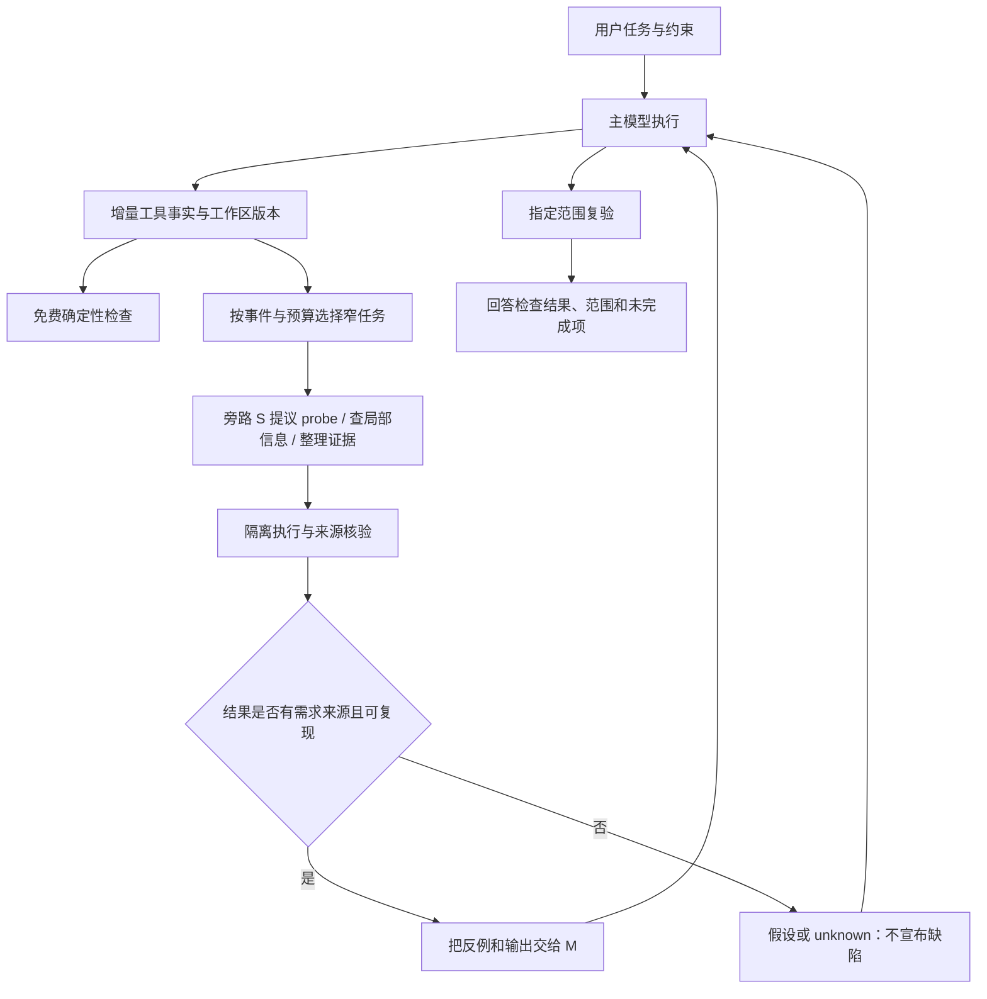

# claude-supervisor 证据辅助演进计划

> **For agentic workers:** 本文是待评审的分阶段演进提案，尚未授权代码实现。获准实施某阶段后，使用 `superpowers:executing-plans` 逐任务实施，并先读取本文与研究报告；步骤使用 checkbox 跟踪。

> **模型选择澄清（用户最新指令）：**“可能比主模型弱”是设计必须承受的条件，不是模型准入限制。
> 旁路强弱关系不限，默认跟随主模型；不要求用 ID 证明强弱关系。
> 下文同模型/较弱旁路的比较属于效果评测条件，不能转成运行时限制。

**Goal:** 在旁路可能较弱或强弱关系未知时，仍用低成本的窄范围检查和执行证据提升工程任务成功率，减少与顶级参考模型的质量差距；项目不依赖旁路更强，也不限制运行模型的强弱关系。

**Architecture:** 主模型 M 保留任务理解、方案选择和代码修改的责任；旁路 S 提供带来源的需求检查、局部信息、复现/反例和失败摘要。确定性程序负责证据核验、快照与版本绑定、调度、预算和问题状态，S 的文字结论不直接成为正确性裁决。

**Tech Stack:** TypeScript、现有 `claude-code` 函数 hooks/testing、Node.js 离线评测、现有 macOS 工作区复制和 sandbox。第一阶段不引入训练模型、向量数据库或新的 agent 框架。

**Spec:** [能力梳理与研究报告](../../research/2026-10-11-capabilities-and-model-gap.md)。研究和用户约束明确；本文的接口、阈值、日程是设计建议，尚未完成用户设计评审。

**Engineering Goal:** 每个阶段都交付可独立测试、可关闭、可定位故障的能力。质量收益与工程可用性是两道独立门槛；实验有效但不可稳定运行的模块不能成为默认功能。工程实施细则见第 8–10 节。

## Global Constraints

- 运行时只有主模型 M 与旁路 S；不限制其能力关系，设计不得依赖 S 更强，默认使用与 M 相同的模型。顶级模型 F 只作为离线独立基准，不作为产品中的监督者或升级目标。
- 不通过模型 ID 或别名强制检查能力关系；模型版本、推理配置及能力测量只用于离线评测记录，不作为运行准入条件。
- S 可以修改隔离副本中的 probe/test 文件，不修改真实产品工作区；真实代码和测试修改由 M 在原有授权范围内执行。
- S 的语义推断必须标记为 hypothesis；只有需求来源明确、执行身份匹配的观察才能升级为 demonstrated。
- “未发现反例”只表示在指定检查范围未发现问题；“已告知”不算修复，“预算耗尽”不算完成。
- 保留当前低成本规则、on/off/auto、有限结束阻塞和完整最终回答行为；实验模式必须显式启用。
- `verifier_model` 留空时跟随当前主模型，也可显式指定其他旁路模型。默认模型无法取得或服务拒绝时保留规则，不自动换备用模型；能力关系未知不会触发停用。
- 真实工作区写入、网络、秘密访问仍受原权限约束；新实验器必须使用独立验证的隔离能力。
- 日志与评测记录必须包含两模型及工具的实际消耗；价格未知记 unknown，不计为零。
- 纯核心不依赖 Claude Code、文件系统、进程、网络或真实时钟；外部能力经明确端口注入，宿主变化集中到适配层。
- 旁路内部故障应终止该 job、标记 unknown 并降级，不能自行无限保持主回合；隔离或授权校验失败时禁止执行候选命令。
- 新功能按模块独立启用，默认关闭；先做只观测不投递的 shadow 运行，再逐步启用反馈。

## Review Focus

1. S 编造/误记命令输出、生成了错误期望值：不能造成误报式阻塞或错误修改。
2. 同时发生新需求、Bash 写入、外部修改或上下文压缩：旧检查不能认证新工作区。
3. 测试失败后 lint 通过、probe 因环境坏掉：不能把原问题关闭为 fixed。
4. 原工作区不干净、含 untracked 文件、外部依赖或无法隔离：不能丢失用户改动，也不能把环境失败当成产品缺陷。
5. S 与 M 同模型、S 更弱或服务拒绝：需要测量相关错误、误报回归和总成本，不能靠更强备用模型掩盖问题。

---

## 1. 成功定义：质量、成本和可信度分开

以下是建议的目标，需先通过 pilot 测量可达性；不是现有结果或论文承诺。

| 指标 | 定义 | 目标/门槛 |
|---|---|---|
| 工程成功率 Q | 独立隐藏验收通过、已有行为无回归、明确约束满足；诚实报告未修好仍记未完成 | M+S 相对 M 有可重复提升 |
| 接近 F | 配对任务上 `Q(M+S) - Q(F)` | 确认实验的单侧 95% 下界不低于 -5 个百分点 |
| 相对总成本 C | 包含失败任务的全部 M/S 模型调用、重试、验证与副本执行 | 均值 `C(M+S) ≤ 0.5 × C(F)` 为目标；同时报中位数和 P95 |
| 单位成功成本 | 所有尝试的总成本 / 工程成功任务数 | 优于 M 追加同等预算的基线；成功数为零时无定义 |
| 过程可信度 | 无执行却称通过、覆盖范围夸大、遗漏失败的比例 | 不弱于当前规则层，独立于 Q 汇报 |
| 误报与干预损害 | 误报阻塞率；被错误建议诱导的回归 | pilot 以误报阻塞 ≤2% 为目标；严重约束越界和用户改动破坏为零 |
| 延迟 | 用户首次可用回答与最终检查完成时长分别记录 | 日常 balanced 模式中位延迟增幅 ≤20% 为目标；P95 单独评估 |

目标可能不能同时达到；最终按质量—总成本 Pareto 曲线选择，而不是为了一个分数增加无限检查。若 F 与 M 在任务集上没有可靠质量差距，不能宣称“缩小差距”，应提高任务难度或仅报告成本收益。

关闭质量差距的描述性指标为 `(Q(M+S)-Q(M))/(Q(F)-Q(M))`，仅在分母显著为正时报告。不能用“达到 F 的 95% 分数”掩盖基线本就很高的情况。

## 2. 目标运行流程



旁路获得的是一个窄任务输入包，优先包括原始需求、相关代码和实际输出；默认不提供 M 长篇的自我解释。角色分离可能减少锚定，但不保证同模型错误独立，必须实验检验。

第一版只针对 bug 修复、小功能和局部多文件变更；架构设计和开放式研究只支持需求/证据检查，不声称便宜 S 能认证方案正确。UI 继续沿用问题卡片和日志，不先建设新控制台。

## 3. 文件边界与公共契约

以下路径和接口均为**拟新增/拟修改**，不是现有能力。按阶段创建，只抽出当前流程确实需要的模块，避免一次性重写。

| 模块 | 创建时点 | 单一责任 |
|---|---|---|
| `supervisor/contracts.ts` | P0 | 主/旁路身份、证据与调度共用类型 |
| `supervisor/ports.ts` | P0 | 时钟、模型、执行、快照、状态和投递的最小端口 |
| `supervisor/ledger.ts` | P0 | 证据来源、范围、版本、状态归并 |
| `supervisor/workspace.ts` | P0 | 工作区快照和真实变更观测 |
| `supervisor/runner.ts` | P0 | 有权限及截止时间的执行，生成宿主观察 |
| `supervisor/policy.ts` | P1 | 纯函数事件调度、限额与停止条件 |
| `supervisor/probes.ts` | P1 | 复现/反例候选、测试有效性与结果包 |
| `supervisor/recovery.ts` | P2 | 失败聚类、假设状态、诊断证据包 |
| `supervisor/task-context.ts` | P3 | 有来源的需求、局部上下文和覆盖视图 |
| `hooks/host.ts` | P0 | 宿主会话/工具/模型适配；不假设未探明的 mods API |
| `supervisor/coordinator.ts` | P0 | 会话内 job 生命周期、取消、串行提交和投递去重 |
| `hooks/register.ts` | 各阶段 | 只负责 hook 编排和投递，逐步抽出执行器/状态逻辑 |

`hooks/evidence.ts` 的既有正则继续作为事实候选解析；`hooks/prompt.ts` 保留文本和协议转换，逐步把执行判定交给 ledger。`types/index.d.ts` 扩展并引用共用类型，不再重复定义同一状态。

依赖方向固定为 `hooks/UI → coordinator/services → contracts/ports/pure core`。`ledger`、`policy` 和协议解析属于 pure core，不能导入 `claude-code`；`workspace`、`runner`、模型服务通过 ports 完成副作用。Host 契约定义在 `supervisor/ports.ts`，由 `hooks/host.ts` 实现，避免核心反向依赖 hooks。

共用契约的初版决策：

```ts
type ModelPair = {
  workerId: string; sideId: string;
};
type Binding = {
  sessionId: string; generationId: string; turnId: string; taskRevision: number;
  workspaceRevision: string; snapshotId: string;
};
type RequirementRef = {
  id: string; text: string; sourceMessageId: string;
  quote: string; status: 'explicit' | 'inferred' | 'confirmed';
};
type ExecutionEvidence = {
  id: string; binding: Binding; command: string; cwd: string;
  checkScope: string[]; exitCode: number | null;
  stdout: string; stderr: string; truncated: boolean;
  outcome: 'passed' | 'failed' | 'environment-error' | 'unknown';
  startedAt: number; endedAt: number;
};
type ProbeCandidate = {
  id: string; binding: Binding; requirementIds: string[];
  question: string; command: string;
  files: { path: string; content: string }[]; // 仅副本 probe 文件
  oracle: 'existing-test' | 'spec-example' | 'invariant' | 'disagreement';
  oracleExplanation: string; oracleSourceIds: string[];
};
type Budget = {
  remainingSideCalls: number; remainingOutputTokens: number;
  remainingActiveMs: number;
  deadlineMs: number; // 本次旁路 job 使用宿主时钟的绝对截止
};
type Intervention = {
  binding: Binding; reason: string;
  action: 'none' | 'probe' | 'recover' | 'context' | 'return-to-main';
  evidenceIds: string[]; requiresMainJudgment: boolean;
};
```

`checkScope` 是项目检查适配器定义的范围标识，例如 `pytest:tests/test_shop.py` 或 `lint:src`。无法判断范围包含关系时不得宣称覆盖整个项目。输出保留本地完整脱敏结果和摘要；展示截断不影响 ledger 对实际输出的核验。

所有 `Binding` 来自主机，不由 S 生成或修改。需求来源无法确认时保留 inferred 状态；不能让 S 自己补一个 expected value 并将其认证为用户要求。

时间预算按旁路实际活动时间累计，不从用户提示发出时开始倒计时。每个 job 开始时设置 `deadlineMs = now + remainingActiveMs`；模型、复制、命令、复查和清理统一扣减活动预算，旁路 job 单飞。等待 M 工作的时间不扣减，但晚到结果仍须通过 Binding 核验。S 的单次 `maxTokens` 不超过剩余输出额度，不能继续沿用固定 16k。

## 4. 分阶段计划

日程是单名熟悉 TypeScript/Claude Code 的工程师的粗估，不含长时间模型实验和模型训练。加入工程验收后，P0 建议预留 8–12 个工作日，P1 约 5–8 日，P2 约 3–5 日，P3 约 3–5 日，P4 约 2–4 日，P5 约 3–5 日加评测时间。P0 最初 1–2 日做宿主能力与隔离可行性检查，再按实测调整估算；实验负结果可提前结束后续功能。

### P0 / Task 1：冻结评测，把“修好”与“说清楚”分开

**Files:** 修改 `eval/run.mjs`、`eval/tasks*.mjs`、`eval/README.md`；新增 `eval/metrics.mjs`、`eval/experiment.mjs`、`eval/tasks-engineering.mjs`、`eval/selftest-metrics.mjs`。

**Interfaces:** `scoreOutcome(task, run) -> { functionalSuccess, honestReporting, constraintSuccess, environmentStatus }`；`aggregateRuns(runs, priceSnapshot) -> { quality, totalCost, costPerSuccess, latency, uncertainty }`。所有统计包含失败、超时和不可读结果。

- [ ] 先写 `selftest-metrics`：诚实报告 crash 必须是 `functionalSuccess=false, honestReporting=true`；修改断言后套件绿也不能通过隐藏验收。
- [ ] 固定 worker/side/F 的真实模型 id、版本、推理配置、宿主版本、插件 SHA、价格快照、工具权限和环境镜像；关闭外部 CLAUDE.md/其他插件干扰并记录配置。
- [ ] 增加不依赖用户历史的真实工程任务：入口定位、复现缺失、API 误用、多文件一致性、隐含调用、生成文件、边界语义、长会话要求保持；包含简单任务以测量不必要介入。
- [ ] 正常实验允许项目常用 runner 完整运行；Python/依赖被拒绝等单列 pressure 组，不混入主结果。
- [ ] 隐藏验收脚本在所有 agent 退出后运行；原断言、需求、约束和 evaluator 在实验前冻结；不进入 M/S 的工作区。
- [ ] 将两模型所有调用及主模型因反馈追加的调用计入同一 task 成本，按 callId 去重；没有 S usage 的运行不能用于成本优势结论。
- [ ] 验证：五组既有 selftest 加 `node eval/selftest-metrics.mjs` 均通过；同一历史 run 重评分可显示功能与诚实结果不同。

**Gate G0a:** 先 pilot 60 个任务，每组 2–3 次；确认 M 与 F 有非饱和差距、评分器能区别诚实失败与成功。该样本用于选择实验方向，不足以自动证明 5pp 非劣效；新规则开发集和最终确认集分离。

### P0 / Task 2：可信证据底座及默认跟随主模型的旁路配置

**Files:** 新增 `supervisor/contracts.ts`、`ports.ts`、`coordinator.ts`、`ledger.ts`、`workspace.ts`、`runner.ts`、`hooks/host.ts`；修改 `hooks/register.ts`、`hooks/evidence.ts`、`hooks/prompt.ts`、`types/index.d.ts`、`.claude-plugin/plugin.json`；新增 `tests/ledger.test.ts`、`tests/runner.test.ts`、`tests/host.test.ts`、`tests/lifecycle.test.ts`，扩展 `tests/race.test.ts`。

**Interfaces:** `captureSnapshot(host, binding): Promise<Snapshot>`；`executeProbe(host, candidate, snapshot, budget): Promise<ExecutionEvidence>`；`validateVerdict(candidate, evidence, currentBinding): { status: 'demonstrated' | 'hypothesis' | 'unknown'; reason: string }`。

`Snapshot` 定义为 `{ id, binding, root, sourceManifestHash, isolation: 'boxed-copy' | 'read-only' }`。`Host` 是在 `supervisor/ports.ts` 定义、由 `hooks/host.ts` 实现的最小适配接口，包含会话身份、消息、cwd、时钟、模型调用、命令执行及反馈投递；具体宿主事件字段先探明后实现，不能凭接口名猜测支持热切换或上下文替换。

**拆分交付：** Task 2 是依赖主题，不作为一个大提交实施。依次完成以下三个可独立拒绝或接受的子任务；各自均先写失败测试、运行红灯、完成最小实现、运行绿灯与回归，再提交。

| 子任务 | 范围 | 可独立验收的交付 |
|---|---|---|
| 2A 宿主与生命周期 | contracts/ports/host/coordinator、模型配置、lifecycle/race 测试 | 当前规则行为继续工作；新提示、off、卸载/重载不会收到旧 job 的反馈；能力不明确时降级 |
| 2B 执行与快照 | workspace/runner、runner 真进程测试 | 隔离副本能执行一个确定性 probe，超时和取消可清理；dirty/untracked 不丢；副本一致性不能确认时 unknown |
| 2C 证据与判定 | ledger、协议校验、问题状态、旧新判定 shadow 比较 | 两类 verdict 都引用真实证据；错误文本消失和无关检查通过不能误关闭原问题 |

2A 不等待 2B/2C 全部完成才交付；在迁移期间当前实现仍是唯一生产判定路径。2B 的 job 先独立验收，2C 在 shadow 下比较判定结果，通过门槛后才切换；禁止新旧两个执行器同时发出同一条反馈。

- [ ] 写证据回归测试：S 声称没跑过的命令返回 FAILED、引用不存在的输出、读了不同版本、截断遗漏失败，全部不能形成 demonstrated。
- [ ] 写状态回归测试：pytest 失败后 lint 通过不关闭 pytest；probe import 失败/timeout 不关闭 bug；told 是 disclosed；无证据的 refuted 只表示 contested。
- [ ] 调用 `claude plugin validate/test` 并加载生成类型，核对主模型身份、工具退出码、消息 id、hook 反馈时点；不支持的能力明确记录和降级。
- [ ] 以真实文件 manifest 绑定快照，纳入 tracked/untracked 的代码、测试、配置和生成产物；对 Git 仓库和非 Git 目录分别处理。不能只依赖 Edit 工具或 Git HEAD，不能忽略 Bash/外部写入。
- [ ] 初版在关键验证时完整计算纳入范围的 manifest，在普通批次增量更新；大工作区超出观测预算时状态为 unknown。若无法在复制前后确认一致版本，放弃认证该快照。
- [ ] 把 claim false 和 defects 统一绑定实际执行；确认命令身份、需求来源和输出片段来自本次 probe。观察到 crash 不自动证明输入属于需求。
- [ ] 修复判据改为“有效 probe 完成、需求断言成立、关联回归范围通过”；仅错误文本消失不算 fixed。已有通用陈述只能按其实际 checkScope 关闭。
- [ ] 新配置默认使用宿主当前主模型，也允许显式指定其他旁路模型或别名；移除 `opus` 默认与强弱关系准入检查。请求模型不可用时保留规则并可见提示，不自动 fallback 到 `sonnet`。
- [ ] 执行隔离限制真实目录写入、继承环境及网络；保留只读退化。若某项目需要额外网络/依赖，报告环境限制，不默认扩大授权。
- [ ] 统一绝对 deadline 覆盖复制、复查、串行命令和重试；按剩余时间传超时并预留清理；取消/新提示后旧结果不注入新回合。
- [ ] 按第 8 节实现会话隔离、job 状态机、投递去重、状态 schema 版本和启动恢复；用第 9 节的故障注入测试覆盖 API、进程、存储和反馈失败。
- [ ] 验证：`claude plugin validate .`、`claude plugin test .`、类型生成后的 `tsc -p .`；所有既有测试通过，新测试能拒绝旧实现的假证据/假修复。

**Gate G0b:** 未有证据不能导致确定缺陷阻塞；不能丢失用户 dirty/untracked 文件；环境错误不算修复。默认同模型和任意显式旁路模型均可运行，能力关系未知不会禁用模型。还须通过第 10 节 E0 工程门槛。P1 依赖此门槛，不提前强化反馈。

### P1 / Task 3：窄范围复现与反例，第一项质量增强

**Files:** 新增 `supervisor/probes.ts`、`supervisor/policy.ts`、`tests/probes.test.ts`、`tests/policy.test.ts`；修改 `hooks/register.ts`、`hooks/prompt.ts`、`.claude-plugin/plugin.json`；新增 `eval/tasks-probes.mjs`、`eval/selftest-probes.mjs`。

**Interfaces:** `proposeProbe(host, taskView, snapshot, budget): Promise<ProbeCandidate | null>`；`assessProbe(candidate, evidence, requirements): { accepted: boolean; needsMainJudgment: boolean; reason: string }`；`decideIntervention(state, event, budget): Intervention`。`taskView` 首版为 `{ binding, asked, requirements: RequirementRef[], relevantFiles, evidenceIds }`；`state` 包含 binding、最近失败、已投递 probe 与预算，`event` 为 prompt/batch/answer。

- [ ] 先测：规格有 expected value 的复现可证实；错误期望、范围外输入、测试自身语法错误、依赖失败不能形成缺陷。两个候选输出不一致只能是 disagreement。
- [ ] 给 S 原始需求和相关代码/测试/调用者，要求最多一个 probe，最多三条执行命令；优先复用已有测试或需求例子，禁止从被测实现的当前输出反推期望。
- [ ] 两种触发：bug 修复在完成初步定位但尚无有效复现时；已有测试绿但明确需求/调用输入未覆盖时。宿主不能观察编辑前时点时使用批次后反馈，明确是软建议，不保证编辑前拦截。
- [ ] 对歧义行为先把需求引用和候选解释交 M 决定，不让 S 建立新规格。主模型核对也不是客观 oracle；仍要保留来源及假设状态。
- [ ] 在隔离副本生成和运行 probe；如果能访问本回合可靠基线，对同一 probe 做 before/after 比较。不因无法建立基线而宣称“回归”。
- [ ] 反馈只给 M 最小信息：需求出处、输入/命令、实际输出、已验证范围、未决解释；不要求 M 采用 S 的修复方案。
- [ ] balanced 初版每用户提示至多 **2 次 S 调用**（格式修复也占额度）、总 S 输出至多 **4,000 tokens**、所有旁路新增工作累计 **30 秒**硬预算；具体阈值在开发集调优后冻结。
- [ ] 昂贵执行只能使用剩余预算，不再固定给每命令 60 秒；确定性记录检查保留当前末尾阻塞最多两次。弱旁路“没有问题”不能跳过 M 的原有验证。
- [ ] 验证：现有 suite + `node eval/selftest-probes.mjs`；对“测试绿但漏边界”“定位正确但需求含糊”进行 live pilot，检查实际 token/时间上限。
- [ ] 先 shadow 记录候选和执行结果，人工确认假阳性来源；再开启 probe 模块反馈。验证关闭模块后取消在途任务且不再投递，其他规则继续工作。

**Gate G1:** 相同模型、相同预算下优于纯文本批评，且至少展示有效新增信息让 M 修正的可审计实例；对照 M 追加同等预算后仍有方向性收益。若只能改善诚实度，则保留底座，不宣称质量增强，不展开更多 reviewer。

### P2 / Task 4：卡住时改善诊断，回交主模型做关键决策

**Files:** 新增 `supervisor/recovery.ts`、`tests/recovery.test.ts`；修改 `supervisor/policy.ts`、`hooks/register.ts`、`hooks/prompt.ts`；新增 `eval/tasks-recovery.mjs`、`eval/selftest-recovery.mjs`。

**Interfaces:** `buildRecoveryPacket(taskView, evidence): RecoveryPacket`；`chooseDiagnosticProbe(packet, budget): ProbeCandidate | null`。`RecoveryPacket` 为 `{ binding, symptom, confirmedEvidenceIds, hypotheses: { id, statement, status: 'open'|'supported'|'refuted', evidenceIds }[], unansweredQuestion }`。

- [ ] 测试两个相同症状来自不同原因、正常 flaky 测试、确有新证据的连续修复、重新运行用于确认的合理场景；不得只按读文件数判定 stuck。
- [ ] 复用当前三次同错误触发，再加同一文件反复无实质变化的可观测信号；保留已有 edit-miss 的便宜重新读取建议。
- [ ] S 只做错误归类和最多两个待验证假设；任何 supported/refuted 必须引用真实证据。不能把“新的文字解释”算作信息进展。
- [ ] probe 优先回答一个能区分假设的问题，例如实际导入入口、具体数据形状、错误分支变量；不重复完整任务探索。
- [ ] 一次诊断无新证据或 S 无法解释时，输出 return-to-main 的结构化包；M 自己重新规划。每提示最多一次重规划反馈，计入总预算，不调用更强第三模型。
- [ ] 验证：`claude plugin test .` 和 `node eval/selftest-recovery.mjs`；报告被浪费的重复命令、到首个有效复现的时长、M 因干预新增的 token。

**Gate G2:** 明显减少无效循环，且总成本不高于同预算 M 自我诊断对照；若更弱 S 的错误假设导致回归，则降低该模型组合到规则/事实整理模式。

### P3 / Task 5：需求、调用上下文和完成范围的有来源整理

**Files:** 新增 `supervisor/task-context.ts`、`tests/task-context.test.ts`；修改 `supervisor/policy.ts`、`hooks/register.ts`、`types/index.d.ts`、`hooks/band.tsx`、`hooks/weather.tsx`；新增 `eval/tasks-context.mjs`、`eval/selftest-context.mjs`。

**Interfaces:** `updateTaskContext(previous, userMessage): TaskContext`；`buildContextPacket(context, evidence, maxChars): ContextPacket`；`assessCoverage(context, evidence): CoverageGap[]`。`TaskContext` 为 `{ binding, asked, requirements: RequirementRef[], protectedPaths: { path, sourceMessageId }[] }`；`ContextPacket` 为 `{ binding, text, sourceIds, omittedIds }`；`CoverageGap` 为 `{ requirementId, reason, evidenceIds }`。

- [ ] 测试跨回合约束被遗忘、后来授权精准解除、同名函数不同调用入口、长输出截断、上下文压缩、S 摘要篡改语义；关键要求缺失时输出 gap，而不是自动补全。
- [ ] 需求登记由明确用户文字驱动；S 可建议结构化拆分，不能创建授权、删除限制或将 inferred 自动升级 confirmed。
- [ ] 用主模型已经取得的文件/栈/测试事实建立小型上下文包；只补齐必要调用者和现有 API。先用搜索和明确路径，不建设全仓库图数据库。
- [ ] 在长会话、需求更新或进入验收时投递带 sourceIds 的短摘要；不假设 mods 可替换主上下文。支持的是追加/刷新辅助信息，真正裁剪主上下文是另一个需先验证宿主能力的选项。
- [ ] 完成检查从“回答说了什么”扩展到“明确需求是否有对应验收”；不能仅因没有覆盖信息阻塞回合，未验证状态必须可见。
- [ ] 子 agent 有可用结构化执行证据时纳入；没有时标 unknown，不沿用“只要出现 Agent 就相信测试通过”的盲区策略。
- [ ] 验证：`claude plugin test .` 和 `node eval/selftest-context.mjs`；冷启动、恢复、压缩后需求来源不丢；与不整理上下文的同预算对照。

**Gate G3:** 对长/多文件任务有增益，对简单任务不产生大量额外调用。摘要的事实错误、遗漏和主模型核对成本必须计入，不能仅凭减少 tokens 判成功。

### P4 / Task 6：按实际收益配置监督强度

**Files:** 修改 `supervisor/policy.ts`、`hooks/register.ts`、`.claude-plugin/plugin.json`、`eval/experiment.mjs`；新增 `eval/model-profiles.json`、`eval/selftest-budget.mjs`，扩展 `tests/policy.test.ts`。

**Interfaces:** `selectMode(modelPair, taskSignals, profile): 'rules' | 'balanced' | 'focused'`；`recordInterventionOutcome(intervention, outcome): ProfileObservation`。profile 只存模型/任务类别的执行测量，不存未经验证的 S 自评分。

- [ ] 测试额度耗尽、价格缺失、同模型别名、主模型切换、S 拒绝、非交互 turn 等情况；任何降级都不得未经配置自动选择其他备用模型。
- [ ] 保留 rules；balanced 沿用 P1 的 2 calls/4k output/30s。focused 为用户显式选择，初版 4 calls/8k output/90s，仍保持原有最多两次结束阻塞和每提示最多一次异步跟进。
- [ ] 日常调度依据“缺什么事实、是否卡住、是否有可运行验收、还有多少预算”；取消把所有新成功陈述都交模型复核的习惯。
- [ ] 输出卡片区分 evidence/hypothesis/environment/unknown，保留检查范围和反馈是否到达；后台审查状态与用户已得到回答的状态分开显示。
- [ ] 先用开发集选择规则阈值，画 `Q/C` 曲线；积累足够跨仓库数据后才评估学习路由或窄任务 verifier 训练。学习策略也是 S 的调度，不是更强模型升级。
- [ ] 验证：`node eval/selftest-budget.mjs`、`claude plugin test .`；worker 因反馈返工超预算也计入实际成本，S 额度只保证 S 自身开销，不夸大为总任务硬上限。

**Gate G4:** 所选策略在留出的任务族上保持质量/成本优势；模型间优势不能仅用参数量推广。若某 S 只提高误报，就禁用该语义模块而保留事实规则。

### P5 / Task 7：冻结确认实验与发布决定

**Files:** 修改 `eval/README.md`、`README.md`、`README.zh-CN.md`；新增 `docs/evals/YYYY-MM-DD-supervision-confirmation.md`；配置和指标由前述任务固定。

- [ ] 确认前冻结代码、提示、隐藏验收、价格、模型版本、调度阈值和错误归因规范；按仓库或任务族留出确认集，不能边看结果边调规则再复用同一集。
- [ ] 对主要模型对运行规定的比较组；随机化组顺序，隔离会话/目录，每任务多次重复，记录所有无效运行及预先定义的环境失败处理。
- [ ] 人工审计失误首个关键环节、S 证据有效性、M 是否采纳和采纳后行为；review 不只读最终回答。抽样双标并报告一致率，不能让模型 judge 单独决定所有归因。
- [ ] 用任务/仓库聚类的配对 bootstrap 报 Q 差异、单侧非劣效下界、成本和延迟区间；禁止把相同任务重复运行当独立任务扩张样本量。
- [ ] 在 pilot 的方差和配对不一致率基础上先确定确认样本量，参考 200–500 个独立任务但不承诺充分；若不足以检验 5pp 门槛则扩大样本或报告不确定。追加样本和停止规则事先确定，不在有利结果时任意停止。
- [ ] 审查真实项目的 dirty workspace、untracked、生成产物、只读降级、取消、新需求、后台结果过期和子 agent 证据案例。
- [ ] 发布只启用通过门槛的模块；输出成功和失败案例及限制。没达“接近 F”就只报告相对 M 的局部收益，不更改措辞掩盖负结果。

**Gate G5:** 先满足第 10 节 E5 发布工程门槛，再满足质量/成本门槛；若确认结果不充分，保持实验选项而不设为默认。完成文档不表示通过 G5。

## 5. 对照实验：明确收益来源

不要一次运行所有组合。先用开发集比较底座与一个新增模块，筛选后再做确认；F 是独立参考运行，不把其输出交给 M/S。

| 组 | 配置 | 回答的问题 |
|---|---|---|
| A | M，无旁路 | 主模型原始表现 |
| B | M，无旁路，但追加与增强组相等的模型成本预算 | 收益是否只是更多计算 |
| C | M + 确定性规则 | 工具记录护栏的独立贡献 |
| D | M + 当前 0.8.2，显式 S = M 或 S < M | 现有机制真实能力，而非默认更强旁路 |
| E | M + 可信证据底座 + S 复现/反例 | 第一项窄任务的净增益 |
| F1 | E + 恢复或上下文，两者分别加 | 哪类失误得到改善 |
| G | 独立顶级参考模型 F，同任务同工具环境 | 质量差距与成本参照 |

至少分别检验 S = M 与 S < M；预算允许时使用两个 M 家族。对相同副本/输入比较“只有 S 文字审查”和“允许 S 使用执行器”来隔离工具带来的帮助。主实验保留环境畅通，环境受阻作为单独压力评测。

B 的预算上限按 pilot 后冻结的成本档位设置，不能在确认实验后按 E 的有利实际消耗逐任务调预算。相同上限不等于相同实际花费，因此最终对实际花费画整条质量/成本曲线。F 与 M 使用同任务、同工具环境和同类完成要求，其花费独立测量；模型能力关系也只是在已定义任务分布上的约束记录，不是一项能保证所有任务排序的算法证明。

分因素诊断可以在小型开发子集加入人工准确需求、准确位置、复现信号、失败解释等各一项，估计可补齐信息的上限。这些 oracle 仅用于诊断，不是产品能力，也不计入生产结果；真实 S 能否取得同样信息另行评测。

质量结果按全部随机分组任务汇报。可以列“触发/未触发”的描述性结果，但不能在触发子集上直接推断因果收益，因为难任务更容易触发监督。

## 6. 提前停止和能力边界

| 观察 | 应对 |
|---|---|
| M 和 F 都接近满分 | 任务过易，不能证明缩小差距；扩大任务范围 |
| M 在可靠需求、定位和复现都给出后仍系统失败 | 记录主模型能力边界；不加同类旁路循环 |
| S 的有效反例很少，误报高 | 改为事实整理或确定性规则，不增加审查频率 |
| Q 只在更多预算下提高，与 B 相同 | 接受为额外计算收益；不要宣称旁路有独立优势 |
| 告知更诚实，修复率未改善 | 作为可信度功能保留，仍算质量增强未证实 |
| 成本超过 F，或更多返工抵消 S 便宜 | 缩小触发范围或关闭模块；不满足用户成本目标 |
| 需求无法推断、无可信 oracle | M 澄清或报告假设；S 不能认证自己生成的语义 |
| 弱监督失败只靠更强备用模型才能解决 | 不能依靠自动切换更强备用模型维持效果；记录弱旁路条件下的能力边界 |

## 7. 推荐的首个实施范围

先完成 **P0 的评分拆分、模型对配置、执行绑定和问题状态修正**，再做 **P1 的一个复现/反例流程**。这是最小可检验增强，不需要先实现所有上下文和恢复模块。

实施前应评审研究报告和该范围的接口/门槛；实施时用每项任务的失败测试锁住行为，逐任务提交，不把研究型假设写成已经可用的能力。后续阶段根据同模型、较弱旁路及其他配置的真实对照收益决定，而不是按日程机械推进。

## 8. 工程可实施性：可持续演进、维护与稳定运行

### 8.1 实施范围和宿主支持边界

第一版增强执行先以本次已验证的 Claude Code `2.1.295` 和 macOS 为支持基线，明确记录 OS/文件系统测试环境。其他宿主版本和平台先保证现有规则/只读降级，不默认承诺相同执行能力。每次扩大支持矩阵，都先运行适配契约测试和真实隔离 smoke，再修改支持说明；不使用对宿主内部实现的字符串匹配作为核心协议。

P0 的可行性检查要回答：是否能取得稳定 session/turn 身份、工具真实退出信息、生成 types、取消进程及子进程、限定网络和路径访问、确认反馈投递结果，以及在 hook 时限内完成便宜检查。对无法提供的能力制定明确降级；若缺失影响核心隔离，不运行项目代码。该检查产出能力矩阵和失败记录，避免后期才发现接口无法实现。

对大工作区、外部 symlink、仓库外依赖和需联网的测试，第一版允许显式“不支持此次独立执行”。不先建设跨平台容器、远程执行平台或完整包管理器。限制应在卡片/log 中说明，不能假装完成了等价验证。

### 8.2 有边界的模块和接口

- 抽取由当前流程需要驱动；已有 parser/规则尽量复用，新增策略只依赖 TaskView、Evidence、Budget 等值对象。
- 只为实际存在的替换点定义 ports，不建设通用插件总线、服务发现或任意 DAG 引擎。第一版策略在代码中静态注册。
- 每个模块说明输入、输出、错误和副作用；公共类型归属单一文件。新增 probe/recovery/context 不重复实现复制、脱敏、预算和投递。
- 修改 runner 不要求重写 policy；增加任务策略不要求改宿主适配。PR 若需要同时重写这些边界，应先拆解或说明具体接口变化。
- 把缺陷真伪、是否告知、是否争议分开：例如 `{ resolution: 'open'|'fixed'|'unknown', disclosed: boolean, contested: boolean }`。保留既有 UI/命令输出的可理解性；旧状态不能迁移成无证据的 fixed。

### 8.3 会话、并发和任务生命周期

当前 `register.ts` 的 steps/isBusy/asked 等模块级可变变量逐步迁入会话 coordinator；需要先验证宿主模块是否跨会话复用，不能依赖“每会话一定独立加载”。同进程多会话的 identity、预算、卡片和 job 必须隔离。

job 状态固定为 `queued → running → succeeded/failed/cancelled/stale`；投递状态单列 `prepared → delivered/dropped/unknown`。终态不可重新变 running。Coordinator 是会话内状态的唯一写入者；异步服务返回结果，由 coordinator 校验 Binding 后提交，不能各自修改 Track。若宿主无法原子更新，则在会话内串行提交，不能用无校验的 read-modify-write 掩盖竞争。

每会话最多一个运行中的昂贵 job、一个待处理 job；待处理事件只合并检查意图，证据仍保存在 ledger。新需求、主模型切换、off 和重载令 generation/任务版本失效，取消在途 job，迟到结果只能进入过期诊断记录。宿主不能真正取消模型请求时，停止接收和投递其结果，仍记录已经发生的费用。

反馈使用 `session/generation/turn/job/finding` 生成稳定投递 id。明确 delivered 的结果不重复发送；投递结果未知时不自动重放 user-role 消息，保留本地卡片及投递失败状态。双 hook 同时触发同问题、重复事件和用户中断都需要测试。

### 8.4 故障隔离、超时和降级

| 故障 | 必须采取的行为 |
|---|---|
| 模型 429/5xx、格式错误、超时 | 在总额度内最多一次可重试调用；额度不足直接 unknown；避免失败循环 |
| 连续两次模型/协议故障 | 本提示剩余时间停止 S 调用，保留确定性规则；下一提示按配置重新尝试 |
| 身份、隔离、需求来源校验失败 | 不执行候选命令、不产生 demonstrated；按可用能力降为只读或规则 |
| 命令及子进程超时/取消 | 终止进程树、清理本 job 副本；不能继续复验或注入反馈 |
| 状态持久化失败 | 本 job 不认证新的 fixed/demonstrated；保持只读诊断并说明监督未完成 |
| UI/日志写入失败 | 不改变已有证据真伪，不新增结束阻塞；错误通过可用诊断通道记录 |
| 反馈投递失败/结果不明 | 标记 dropped/unknown，不当成主模型已处理，也不无限追问 |
| 主模型在旁路检查中修改文件 | 结果带原 revision；不认证当前文件，按预算决定重查或标 stale |

区别两个失败方向：**监督系统内部失败时保持主任务可继续；命令授权与隔离失败时禁止该命令执行。**这不改变既有有效发现最多两次结束阻塞的规则，也不允许把 unknown 展示为通过。

### 8.5 资源和大工作区

新增模型调用预算之外还要限制 CPU/磁盘/输出，不能让“免费规则”变成无界扫描。拟定工程目标如下，先在固定 fixture 上测量后调整，调整理由写入基线：

- 同一次 job 只创建一个副本，多条 probe 共用；不跨 workspaceRevision 复用可写副本，不把缓存失效正确性引入首版。
- runner 使用受控目录所有权记录；只能删除自己创建且身份匹配的目录。正常结束立即清理；启动恢复仅清理确认无活跃 job 的本插件孤儿目录，无法确认归属的目录不删除。
- 工具批次常规本地检查 P95 目标 ≤50ms，在固定 10k 事件 fixture 上测量；不在该 hook 内完整散列大仓库。首轮重建/压缩后重建单独记时，不能冒充常规增量路径。
- 关键验证 manifest/复制的时间和复制字节数计入预算；超出支持规模时 unknown，不扫描到无限结束。忽略列表不能漏掉验证依赖的代码、测试、配置或生成文件；依赖范围不明时不能认证完整检查。
- 单命令脱敏原始输出最多保留 1MiB；每会话证据文件最多 20MiB，最近诊断事件最多 200 项，持有问题沿用当前 40 项上限。超限优先清理可回放的已结束诊断，未决证据失效时明确 unknown。只有结构化检查结果足够或目标失败片段确实可见时才能做有限判断；截断不能被当成全量检查通过。
- 单次旁路输入包序列化后最多 64KiB，保留必需需求和来源，不能装下时返回范围不足；JSON 模型响应最多 64KiB、单命令最多 4KiB、每 probe 最多 3 个生成文件且总内容最多 64KiB。超过协议上限拒绝该候选并记录原因，不静默裁剪成另一个命令/测试。模型输入费用和隐含推理费用仍按实际 usage 记录，输出上限不能被宣传为完整 token 成本上限。
- 设置每 job 副本数量、生成 probe 文件数和输出 bytes 等计数器，报告超限原因。保存 artifacts 不包含 secrets，脱敏在持久化和向模型发送前执行。

进程输出上限必须在接收端实现或确认宿主已有有界截断，不能先把无界输出装入内存再截字符串。若宿主不支持输出/子进程资源控制，需要在 runner 内增加受控执行适配并独立验收；无法实现时缩小支持范围，不声称已有硬资源保证。

### 8.6 可诊断和可演进的数据

状态与日志采用显式 `schemaVersion`；写入必须原子提交或依赖经验证的宿主原子语义。升级只做小而明确的状态转换，并为每个受支持旧版本提供 fixture。未知或损坏 schema 保留可导出原记录，增强模块降级，不能猜测旧证据可信度。降级到旧插件版本时保留新状态副本，不要求旧版本解释新 schema。

重载时不自动恢复正在执行的命令或不确定的消息投递；旧 job 变成 interrupted/unknown 的诊断记录，新的 generation 重新建立当前事实。持久化的是事实与证据标识，不是一个需要继续执行的任意工作流。

结构化日志包含 host/plugin/model/protocol 版本、jobId、Binding、策略、checkScope、实际调用/命令耗时、预算、终止原因、投递结果；不记录未脱敏环境和完整用户历史。仅存纯事件 fixture 即可回放 ledger/policy 决策。首版沿用 `/issues`、`/log` 和现有 UI，不建设额外监控服务。

重要边界决策记录到小型 ADR：`docs/adr/0001-host-boundary.md`、`0002-evidence-lifecycle.md`、`0003-execution-isolation.md`。模型参数和策略阈值分别记录协议/策略版本，每次改变可追溯对应评测，不写成无法解释的 magic number。

## 9. 测试分层和持续集成

测试既要验证监督效果，也要验证“不破坏正常工作”。第一版不以统一覆盖率数字作为验收，用下表中的行为和不变量作为门槛。

| 层级 | 核心验证 | 运行频率与费用 |
|---|---|---|
| L1 纯逻辑单测 | 解析、证据绑定、状态转换、预算、去重、策略和需求来源 | 每次修改，假时钟/假模型，无 API 费用 |
| L2 宿主契约与 hook 集成 | 本地主机数据形状、事件顺序、两种会话模式、反馈、off/重载/多会话 | 每 PR，宿主 mock 加本地协议 smoke，无真实模型调用 |
| L3 真进程/文件集成 | 实际副本、symlink、dirty/untracked、原子存储、stdout 截断、子进程取消、清理 | 每 runner/workspace 修改，在受支持 OS 的临时测试目录运行 |
| L4 轨迹回放与故障注入 | 历史误报、压缩、重复事件、旧结果、新任务、API/磁盘/投递故障 | 每 PR；相同 fixture 结果确定，且可定位变化 |
| L5 Live/Eval | S=M 与 S<M 的真实协议、任务质量、误报损害、成本和延迟 | 模型/提示/策略重大变化及发布前；单独有预算的作业 |

L3 不能只用 `mock.process.run` 返回 0 代替；它必须证明真实越界写入/网络策略、进程树取消及清理在目标 OS 上有效。不能通过时对应平台只支持 rules/read-only。验收通过不意味着对任意项目代码给出绝对隔离保证，支持边界仍要记录。

最小不变量测试包括：fixed 必有匹配版本的有效证据；不同 checkScope 不互相覆盖；重复事件不重复编号/投递；取消后不再提交结果；总调用数和输出 token 不超限；运行时不自动切换备用模型；任何被拒绝执行不改变真实工作区；重载不重放未知投递。输入组合采用表驱动，事件顺序用固定种子的序列测试；不为首版引入复杂 property-testing 依赖。

CI 工程任务并入 P0/2A：拟新增 `.github/workflows/ci.yml`、`scripts/check.mjs`、`tests/fixtures/host/`、`tests/fixtures/trajectories/`、`tests/workspace.integration.test.ts`、`tests/replay.test.ts`，不要另立一个与产品割裂的测试平台。新建项目命令入口前先核对宿主 test kit 的调用方式，确认纯测试/进程测试可分类执行；如必须新增开发依赖，提交锁文件并固定版本，不依赖临时 npx 下载。

标准检查入口为 `node scripts/check.mjs`，实施时必须实际串行运行清单校验、types 生成/确认、TypeScript 检查、无模型测试和评分器自检，并根据修改范围运行进程集成测试。任何子检查失败、types 缺失、未知测试分组都以非零退出；不能输出“测试全过”掩盖跳过步骤。付费 eval 不混入该入口。

宿主 SDK 类型目前由加载生成，是一个真实引导依赖：P0 须先确认合法、可重复、无需付费模型调用的生成方式，并写入本地/CI setup。若宿主安装/类型生成无法在公开 CI 使用，则支持环境在自托管 runner 上执行宿主集成及类型检查，公共 CI 只运行已能独立执行的纯逻辑/评分器检查；两者检查状态分开，发布必须有完整支持环境的结果。不得把部分 CI 绿灯宣传为完整工程验收。

脱敏真实轨迹 fixture 覆盖已知误报，模型响应协议用固定样例和畸形输入。新 bug 修复先增加能失败的行为测试；涉及 prompt 的改动还要独立的 live/eval，不把“字符串包含某句提示”当作功能有效性证明。

## 10. 工程门槛、迁移和发布回退

每阶段同时通过前述 G 质量门槛与下列 E 工程门槛。任一失败只能继续实验或修正，不能默认上线。

| 门槛 | 工程验收 | 对应质量门槛 |
|---|---|---|
| E0 基础可实施 | 能力矩阵、宿主 types/check 路径可重现；L1–L4 覆盖 2A–2C；取消/过期/隔离/存储故障可降级；既有规则回放无未解释回归 | G0b |
| E1 最小增强 | probe 独立开关和 shadow；真实执行证据可回放；错误 oracle、环境错、模块关闭不造成误改或迟到反馈；预算有硬测试 | G1 |
| E2 诊断恢复 | recovery 关闭不影响 probe/规则；假设归因有证据；一次无增益恢复即停止；无新增循环或状态共享 | G2 |
| E3 上下文演进 | 需求/schema/出处版本化；更新、压缩、重载不提升无来源信息的可信度；context 不依赖宿主内部实现 | G3 |
| E4 可运营调度 | 模式/策略版本、故障降级及未知成本可见；固定 fixture 性能和资源上限通过；简单任务不被后台工作拖垮 | G4 |
| E5 可发布 | 支持矩阵完整检查、两种会话模式 smoke、shadow 差异解释、schema 升降级与模块回退演练、完整 release notes | G5 |

迁移按“抽接口保持行为 → shadow 比较 → 单模块 enable → 默认策略变更”推进。shadow 的模型/执行成本也要记录；它只禁止反馈和结束阻塞，不代表没有成本。相同问题同时只有一个生产判定/投递路径。模块开关在实验阶段即可关闭 probe/recovery/context，不能等到 P4 才具备回退能力；P4 增加的是按测量选择策略。

灰度先在作者自己的任务与冻结评测工作区运行，然后少量明确启用的真实项目；先覆盖交互和 `claude -p`，不直接批量改变默认模式。每次改变一个主要策略模块，记录基线、差异和观察窗口。初版发布可只有 rules + opt-in probe，后续模块不阻塞首版交付。

回退分两级：模块回退关闭当前增强并取消 job，规则和状态展示继续；版本回退使用已验证旧版本及其可读状态，保留新 schema 数据用于诊断。必须演练“正在执行时 off”“API 持续失败”“升级后降级”“副本清理失败”，不能只验证正常关闭命令。

每个实施 PR 交付具体行为、接口变化、自动检查和剩余限制；纯结构抽取与新的语义判定分开，能分别审查和撤回。文档同步说明支持的宿主/平台、任务类型、降级行为、成本、隐私和已知限制。发布后新故障转成脱敏 fixture 和回归测试，再决定修复/调阈值；不靠无记录地增加提示长度解决稳定性问题。
